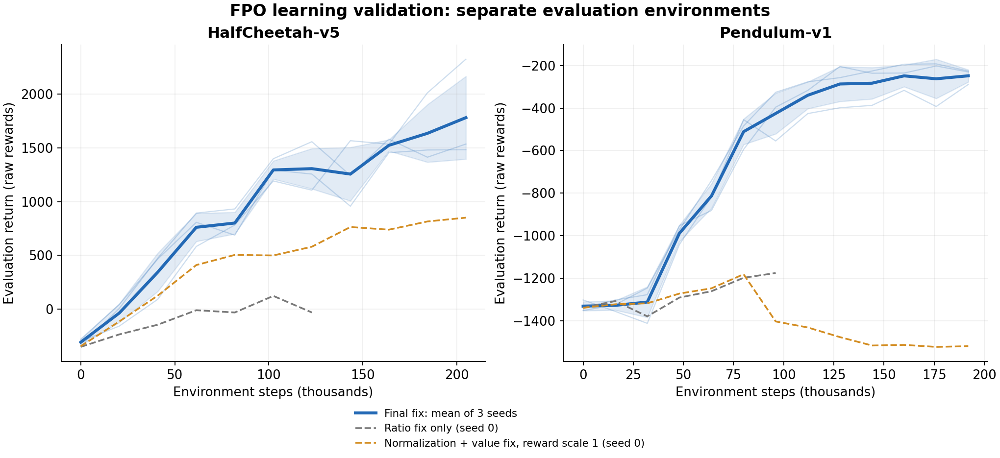

# FPO 修复与学习实验

2026-10-01，在 CPU 上实际采集环境交互、更新策略，并用独立环境评估回报。
修复后的 HalfCheetah-v5 和 Pendulum-v1 在三个训练种子上均提升回报。
只修改 FPO 比率公式的中间版本仍会停滞，因此最终同时修复了示例的价值拟合和输入、奖励尺度。

## 最终结果

每项是 4 个独立评估 episode 的平均原始回报，取最后一个检查点，没有选择最佳检查点。

| 环境 | 训练种子 | 环境交互步数 | 初始回报 | 最终回报 |
| --- | ---: | ---: | ---: | ---: |
| HalfCheetah-v5 | 0 | 204,800 | -345.78 | 1536.58 |
| HalfCheetah-v5 | 1 | 204,800 | -300.33 | 2326.71 |
| HalfCheetah-v5 | 2 | 204,800 | -280.24 | 1483.79 |
| **HalfCheetah 平均** | **0、1、2** | **每种子 204,800** | **-308.78** | **1782.36** |
| Pendulum-v1 | 0 | 192,000 | -1339.77 | -230.51 |
| Pendulum-v1 | 1 | 192,000 | -1352.83 | -226.06 |
| Pendulum-v1 | 2 | 192,000 | -1302.88 | -289.10 |
| **Pendulum 平均** | **0、1、2** | **每种子 192,000** | **-1331.83** | **-248.55** |



蓝色粗线是三个训练种子的平均值，浅色细线是各自的结果，阴影是种子间一个标准差。
灰色、橙色对照各只运行了种子 0。阴影不是置信区间。

完整记录见 `halfcheetah_scaled_seed{0,1,2}.json` 和
`pendulum_scaled_seed{0,1,2}.json`，每个检查点含 4 个评估回报、训练指标、
本轮策略参数变化量和运行时间。

## 修复内容与对照

RLAlg 的默认比率改为先平均 CMF 损失差、再求指数，并在平均之后限幅。
每个动作使用一个比率，和[论文算法 1](https://arxiv.org/html/2507.21053v2#S3)一致。
逐样本比率保留为显式消融选项。旧损失、动作、噪声、时间与优势固定为 rollout 目标，
防止附着的旧损失计算图抵消当前策略梯度。采样和损失调用共用模型接口，支持
关键字时间参数以及不同前导批次维度，且不再隐藏模型内部抛出的 TypeError。

示例默认取消末端额外噪声，随机初始噪声负责探索；网络始终预测速度。
速度方向和噪声重建公式与[作者实现](https://github.com/akanazawa/fpo/blob/main/playground/src/flow_policy/fpo.py)一致，
没有把网络错误地改成直接预测噪声。

价值损失不再复用策略的比率裁剪参数。两者单位不同，过小的价值裁剪范围会让
已经超出范围、但仍远离 return 的价值预测失去改善方向的梯度。
示例默认使用未裁剪的价值 MSE，提供独立的 `--value-clip-range` 选项。
观测统计在 rollout 及其更新期间冻结，只在下一段 rollout 开始前更新，
保证缓存的旧 CMF 损失和当前损失使用相同输入变换。

训练奖励默认乘 0.1，bootstrap 值不再乘第二次；评估和 episode 日志使用原始奖励。
这项设置在相同种子 0、相同观测归一化和未裁剪价值损失的对照中具有明显影响：

| 设置 | HalfCheetah 最终回报（204,800 步） | Pendulum 最终回报（192,000 步） |
| --- | ---: | ---: |
| 观测归一化、未裁剪价值损失、奖励尺度 1 | 851.15 | -1520.30 |
| 同上，奖励尺度 0.1 | 1536.58 | -230.51 |

只改比率公式、仍把 0.05 用于价值裁剪且不归一化观测的中间版本，
HalfCheetah 在 122,880 步时为 -31.27，Pendulum 在 96,000 步时为 -1176.17。
旧库和原示例行为的 HalfCheetah 对照也曾提高回报：种子 0 在 81,920 步时为
693.04，122,880 步时为 287.26。因此这些实验不支持“旧实现始终没有梯度”；
它们支持修正默认 FPO 目标并同时处理训练配置，不能把全部收益归因于单项修改。
各阶段原始数据保留在 `ablations/`，旧库基线为 RLAlg 提交 `d0fceb5`。

归一化后的优势均值为零，所以更新前的 policy loss 接近零是正常现象。
CMF loss 也不必单调下降：负优势动作会被主动降低拟合程度。
判断是否学习应看独立评估回报，同时确认参数变化和训练指标有限。

## 实验设置与复现

- Python 3.12.13，PyTorch 2.11.0+cu128（实际使用 CPU），Gymnasium 1.2.0，MuJoCo 3.8.0。
- 8 个训练环境；HalfCheetah 每轮 256 步、100 轮，Pendulum 每轮 200 步、120 轮。
- 每轮遍历 rollout 10 次，batch size 256；Adam 学习率 3e-4。
- Actor/Critic 为两层 128 单元网络；梯度范数上限 1，gamma 0.99，GAE lambda 0.95。
- 8 步 Euler，10 个 CMF 样本，连续时间采样，噪声重建监督，策略裁剪 0.05。
- 观测归一化开启、价值损失不裁剪、奖励尺度 0.1。
- 每 10 轮评估一次；评估重置种子 801–804，初始噪声生成器种子 919。
  评估不更新统计，也不消耗训练的 PyTorch 随机数。

在 RLDemos 目录中、使用已更新的 RLAlg 运行：

```bash
python -m FPO.benchmark --env HalfCheetah-v5 --seed 0 --epochs 100 --output FPO/results/halfcheetah_scaled_seed0.json
python -m FPO.benchmark --env Pendulum-v1 --seed 0 --epochs 120 --rollout-steps 200 --output FPO/results/pendulum_scaled_seed0.json
```

再分别将 `--seed` 和输出文件后缀改为 1、2。MuJoCo 环境需要 Gymnasium 的
MuJoCo 依赖；本次使用本机已有的 isaaclab Python 环境，没有另外安装依赖。
上述脚本默认使用 CPU 和一个计算线程，数值可能随运行库版本变化。
如需重画曲线，在安装了 Matplotlib 的环境中运行 `python FPO/results/plot_results.py`。

## 回归检查

RLAlg 137 项测试、RLDemos 49 项测试通过。新增检查覆盖比率聚合、指数限幅、
冻结旧目标、梯度方向、固定噪声采样、时间参数与批次维度，以及三个种子的真实
rollout 奖励学习。示例还验证价值更新可越过策略裁剪范围、观测统计冻结、
超时 bootstrap 不被重复缩放，以及独立评估不改变训练状态。
